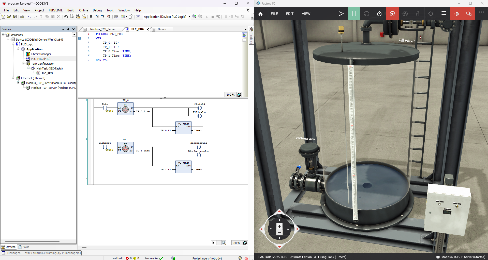

# Filling Tank with Timers

Timers in ladder logic controlling a filling tank in Factory I/O.



## What it does

- Pressing **Fill** starts a TP (pulse) timer. The fill valve and the Filling indicator stay on for the timer's preset time.
- Pressing **Discharge** starts a second TP timer. The discharge valve and the Discharging indicator stay on for its preset time.
- The elapsed time of each timer is converted with `TO_WORD` and written to the `Timer` output, so the value can be sent to Factory I/O.

## Factory I/O scene

Scene: *3 - Filling Tank (Timers)* (Factory I/O v2.5.10)

## I/O mapping

| Direction | CODESYS variable | Factory I/O tag |
|---|---|---|
| Input | `Fill` | Fill (Input 0) |
| Input | `Discharge` | Discharge (Input 1) |
| Output | `Fillvalve` | Fill valve (Coil 0) |
| Output | `Filling` | Filling (Coil 1) |
| Output | `Dischargevalve` | Discharge valve (Coil 2) |
| Output | `Discharging` | Discharging (Coil 3) |
| Output | `Timer` | Timer |

The output order must match the coil order in Factory I/O. Check each variable against its coil number.

## Variables

```
PROGRAM PLC_PRG
VAR
    TP_0: TP;
    TP_1: TP;
    TP_0_Time: TIME;
    TP_1_Time: TIME;
END_VAR
```

## Ladder logic

```
Rung 1:  --[ Fill ]------[TP_0, PT]----+--( Filling )
                                       +--( Fillvalve )
                                       +--[TO_WORD(TP_0.ET)]--> Timer

Rung 2:  --[ Discharge ]-[TP_1, PT]----+--( Discharging )
                                       +--( Dischargevalve )
                                       +--[TO_WORD(TP_1.ET)]--> Timer
```

## Project file

`codesys/` contains the CODESYS project file.

## Problems I ran into

- **Red triangle on the Modbus device:** caused by a configuration problem. Checking the device's IP, port, unit ID and channel lengths fixed it.
- **Outputs in the wrong order:** two output bits were swapped compared with Factory I/O's coil order, so the wrong valve reacted.
- **Same name for an input and a coil:** an output coil must use its own variable, not the name of an input.
- **Choosing the right timer:** TON delays the start, TOF holds the output after the input drops, and TP gives a fixed pulse. TP fits a fixed fill or discharge time.
- **Timer value:** `TO_WORD` on a TIME gives milliseconds, and a WORD overflows above 65,535.

## What I learned

- Timer types and when to use each
- Mapping Modbus coils and registers between CODESYS and Factory I/O
- Reading online values to debug a program

## Tools

CODESYS, CODESYS Control Win V3, Factory I/O, Modbus TCP
